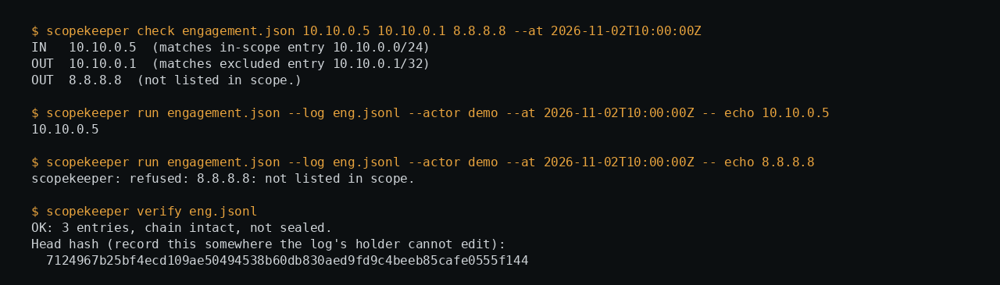

# scopekeeper

A scope guard and tamper-evident log for **authorised** security testing. It does not scan or attack anything. It answers two questions a tester is later asked: *was I allowed to touch that?* and *what exactly did I run?*

- `scopekeeper run` checks every target in a command against your written scope and time window, refuses if anything is out of scope or cannot be classified, otherwise runs the command and logs it.
- The log is an append-only SHA-256 hash chain that records which scope file (by hash) authorised each action, and the exit code.
- No dependencies, no network, no DNS lookups. Python 3.9+.

```bash
scopekeeper init engagement.json                     # template; edit to match your written authorisation
scopekeeper check engagement.json 10.10.0.5 app.example.com
scopekeeper run engagement.json --log eng.jsonl -- nmap -sV 10.10.0.5
scopekeeper run engagement.json --log eng.jsonl --dry-run -- nmap -iL targets.txt
scopekeeper note eng.jsonl "Weak TLS config on host A" --evidence screenshot.png
scopekeeper verify eng.jsonl                          # prints the head hash: store it somewhere you cannot edit
scopekeeper verify eng.jsonl --expect-head <hash>
scopekeeper report eng.jsonl > log.md
scopekeeper check engagement.json 10.10.0.5 --json    # machine-readable, for a CI gate
scopekeeper verify eng.jsonl --json
scopekeeper report eng.jsonl --format json
scopekeeper keygen eng.key                            # optional: secret key for sealing entries
scopekeeper run engagement.json --log eng.jsonl --key-file eng.key -- nmap -sV 10.10.0.5
scopekeeper verify eng.jsonl --key-file eng.key       # every entry's seal must match the key
```

`check`, `verify` and `report` all accept a JSON output mode (`--json` on `check`/`verify`, `--format json` on `report`), so a pipeline can gate on the exit code and still get structured detail without scraping text.

### Sealing (optional)

With `--key-file` (or the environment variable `SCOPEKEEPER_KEY_FILE`) each new entry also carries an HMAC-SHA256 of its hash under your secret key. A plain hash chain can be rebuilt end to end by anyone who can edit the file, because the hashes need no secret; with seals, a rebuilt or edited log fails `verify --key-file` unless the forger also holds the key. A log is sealed throughout or not at all: a sealed log refuses an unsealed append, and a key refuses to extend a log whose existing entries do not verify under it. `verify` without the key still checks the chain and reports how many entries are sealed, but says plainly that the seals were not checked. Keep the key off the machine under test and away from whoever holds the log. It is a symmetric key, so anyone who can verify can also forge: this is tamper-evidence, not proof of who wrote an entry. Truncating the end of the log is still only detected with a recorded head hash (`--expect-head`).

Exit codes: `check` 0 all in scope, 1 any out, 2 error. `run` returns the command's own exit code, `3` if refused, `2` on error.

Try it: `PYTHONPATH=src python -m scopekeeper check examples/engagement.json 10.10.0.5 10.10.0.1 --at 2026-11-02T10:00:00Z` (the `--at` option replays a time and exists for testing).

## Scope file

JSON with `engagement`, `authorized_by` (who authorised it and the reference of the written authorisation), `window.start/end` (ISO 8601 with timezone), `in_scope` and optional `out_of_scope`, each with `domains` (`app.example.com` exact; `*.example.com` any subdomain, not the apex), `cidrs` and `ips`. Exclusions win.

## Limits

- **Guard rail, not a sandbox.** Targets are extracted from the command line (including `-iL` list files, URLs, `user@host`, `--opt=value`). Targets supplied through config files, environment variables, stdin or other indirection are not seen. A determined user can bypass it. Unrecognised shapes fail closed.
- **Hostnames are not resolved.** See docs/RESEARCH.md.
- **Hash chain limits.** Editing or deleting an entry in the middle is detected. Truncating the end or rewriting the entire file is not, unless you recorded the head hash elsewhere. Without `--key-file`, entries are unsealed; with it, they carry a symmetric HMAC seal (not a public-key signature).
- POSIX file locking only; one writer at a time on Windows.
- Not legal advice or a substitute for a signed rules-of-engagement document.

## Roadmap

Not done yet, in rough order of value:

- Asymmetric (public-key) signatures per actor for real non-repudiation. The current HMAC seal is symmetric and needs no third-party library; an asymmetric scheme would need one.
- Windows-safe concurrent writers (currently POSIX file locking only).
- Recognising targets passed through a config file or `--opt=value` form the extractor does not yet know about; see docs/RESEARCH.md for the shapes currently covered.

## Development

`python -m unittest discover -s tests` (33 tests, including real subprocess runs proving that refused commands do not execute and that shell metacharacters are inert).

Not yet independently reviewed; the tests and documented limits describe what has been checked. MIT licence.

Designed and built by Maak — https://github.com/0xM44k

## Evidence



The image above is a capture of the command shown at the top of the image, run against the files in this repository on 2026-11-01. It is the tool's actual output, rendered in a terminal panel for legibility; no output lines were invented.
